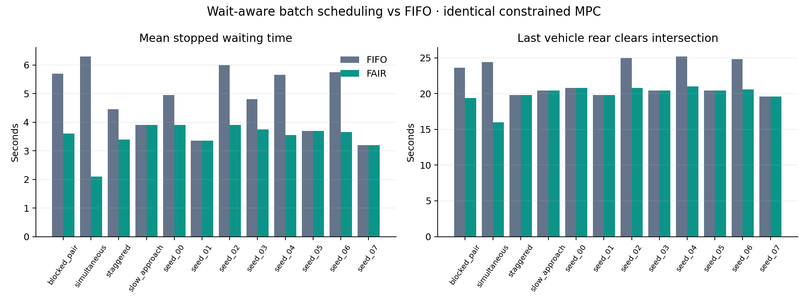
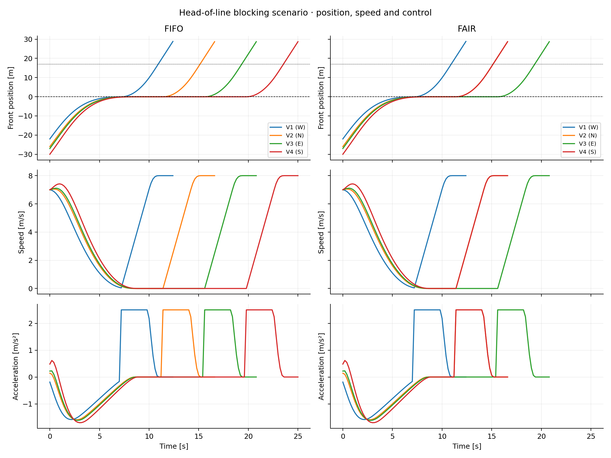
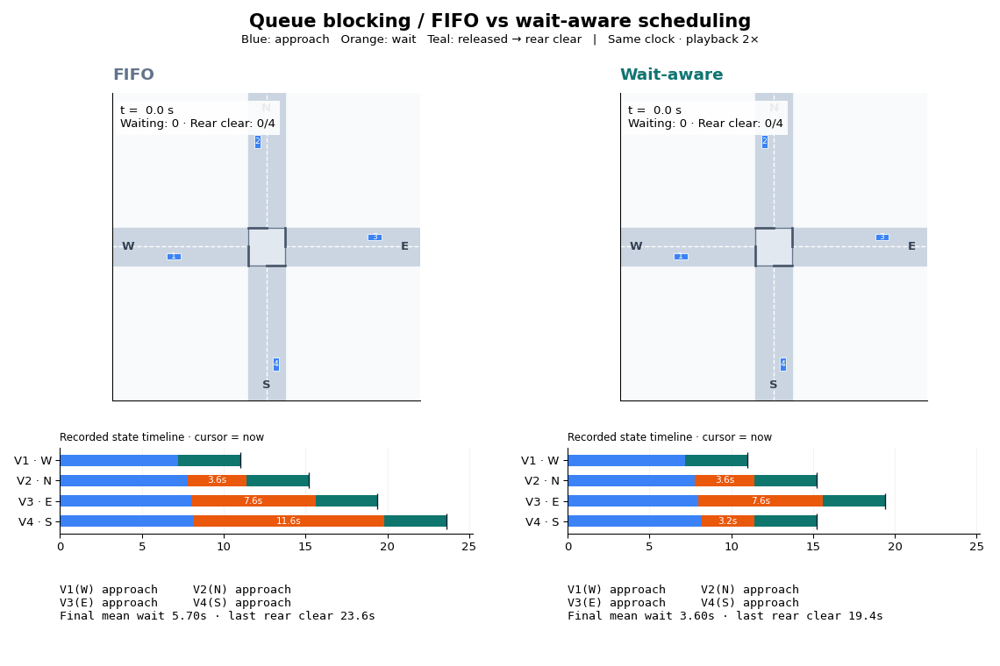

# Wait-aware batch scheduling with constrained MPC

Narain's experiment on `narain/intersection-control`: improve how an all-way-stop
intersection chooses its next vehicles, while keeping every vehicle's motion
inside explicit acceleration, speed and stop-line constraints.

The original `all_way_stop.py` and its plots are preserved. Run `fair_mpc.py` for
this version.

## Run

```bash
python3 -m venv .venv
source .venv/bin/activate
python3 -m pip install -r requirements.txt
python3 -m unittest -v
python3 fair_mpc.py --animate
```

The last command runs 12 scenarios under both policies and exports CSV traces,
metrics, six charts, and three annotated GIFs to `results/fair_mpc/`. It runs without
opening a graphical window. For a shorter four-scenario run, use `--seeds 0`;
use `--output /tmp/fair-mpc-demo` to keep it separate from the recorded results.

Start with the [visual guide](VISUAL_GUIDE.md) for the animations, charts, and
what each one establishes. Four new chart figures also include SVG exports for
scaling cleanly in a presentation. GIFs replay at 2× simulation speed, share a
single clock between policies, and include recorded state timelines and live
waiting/clearance counts. Their footer explicitly labels final summary metrics.

## What is different

The remote branches were fetched and inspected on November 10, 2026:

| Branch | Observed direction |
| --- | --- |
| `main` | Longitudinal MPC; FIFO with an opposing second car allowed |
| `feat/removedfifo` | Trajectory-conflict logic and vehicle-body collision penalties |
| `feat/2d-ellipse` | 2D longitudinal/lateral control, acceleration limits, road bounds and obstacle experiments |
| `feat/2d-ellipitcal` | Dynamic elliptical potentials, alternative penalties/solvers and a jerk cost |
| `vivaan-shah-test` | Ellipse versus superellipse collision potentials |
| This version | Age-aware selection of compatible batches, with a controlled FIFO comparison |

Opposing-car concurrency already exists in `main`. The contribution here is
**searching beyond the next queue entry and trading batch size against waiting
age**, with an explicit oldest-car rule. It does not claim to invent concurrent
crossings, acceleration bounds, or jerk penalties.

### Scheduling policy

1. Vehicles approach, slow to at most 0.05 m/s within 0.10 m before the stop line,
   and enter the waiting queue. No position or speed is reset at this transition.
2. Enumerate each waiting singleton and each compatible opposing pair. Only
   straight-through N/S and E/W pairs are compatible.
3. Score a candidate batch by `sum(1 + waiting_time_seconds)`. The unit service
   reward makes larger batches useful; waiting time gives older vehicles urgency.
4. If the oldest waiting vehicle has waited at least six seconds, restrict the
   candidates to batches containing it. Resolve ties deterministically by queue
   priority.
5. Release the chosen batch, then wait until **every rear bumper** clears the
   intersection plus 0.5 m and a further 0.4 s guard time elapses.

For example, the queue `W, N, E` makes FIFO release W alone because N conflicts.
The new policy can select W and E together. Conversely, if N has become overdue,
the oldest-car rule can prioritize N over a younger W/E pair.

Six seconds is an **eligibility threshold at the next dispatch**, not an absolute
maximum wait. An active batch is never interrupted. The default benchmark does
observe waits exceeding six seconds.

### Motion controller

Both policies use the same 5 s prediction horizon, 0.2 s sampling period, and
constant-acceleration dynamics:

```text
p[k+1] = p[k] + v[k] * dt + 0.5 * a[k] * dt²
v[k+1] = v[k] + a[k] * dt
```

Hard constraints enforce `-4 <= a <= 2.5 m/s²`, `0 <= v <= 8 m/s`, and
`p <= 0` while approaching or waiting. The STOP objective penalizes terminal
position error relative to -0.03 m and terminal speed. The GO objective tracks
8 m/s. Both penalize acceleration effort and changes in acceleration, including
the change from the previously applied input. Jerk is a soft objective, not a hard
limit.

With fixed routes these are convex quadratic objectives with linear constraints.
SLSQP receives an analytic gradient, a positively rescaled objective, and a
shifted previous plan. Every returned plan is checked for feasibility. If a solve
fails, the shifted plan is reused only if it satisfies the current constraints;
otherwise the simulation raises an error. It never silently applies an unchecked
optimizer result. No external QP solver is required.

## Recorded comparison

The baseline reproduces `main`'s **FIFO selection policy**, including allowing an
opposing second queue entry. It uses this experiment's constrained MPC and rear
clearance rule. These results isolate scheduling; they are **not** a benchmark
against the original unconstrained `all_way_stop.py` executable or other branches.

There are four named scenarios and eight scenarios generated with fixed random
seeds 0–7. Each policy receives exactly the same initial conditions.

| Metric across the 12 scenarios | FIFO | Wait-aware |
| --- | ---: | ---: |
| Average of scenario mean waiting times | 4.8125 s | 3.5000 s |
| Average last rear-clearance time | 22.0167 s | 19.9167 s |
| Largest individual wait observed | 12.6 s | 8.2 s |
| Average of scenario jerk RMS values | 1.596 m/s³ | 1.669 m/s³ |
| Minimum sampled body clearance | 2.024 m | 2.024 m |
| Reused fallback plans | 0 | 0 |

Mean waiting decreased **27.3%** and average last rear-clearance time decreased
**9.5%**. Waiting improved in eight scenarios and tied in four. All 24 runs
completed with no detected overlap or checked constraint violation. Ride comfort
did not improve: jerk RMS was approximately 4.6% higher. Some individual drivers
also wait longer: in the staggered scenario, V2's wait increases from 3.8 to 8.0 s
while the scenario mean decreases. All 16 unit tests passed; results are limited
to this benchmark.







Exact per-run measurements are in [metrics.csv](results/fair_mpc/metrics.csv).
Each scenario/policy also has a trace CSV containing time, vehicle, approach,
state, front-bumper position, speed, acceleration and finite-difference jerk.
`vehicle_events.csv` records each vehicle's stop, release, rear-clearance and wait
times; `dispatch_batches.csv` records which vehicles were released together.
`visual_validation.csv` records the event/trace and sampled-gap/metric checks for
all 24 runs. These checks run before visual export and raise on a mismatch.

Waiting time means release time minus queue-registration time. Clearance time is
the time the last vehicle reaches the rear-clearance threshold, measured from
the start of the simulation. Jerk RMS includes the initial input transition and
the common simulation period, including completed vehicles' zero controls.
Body clearance is the gap between axis-aligned vehicle rectangles, sampled every
20 ms; a negative value denotes overlap. Solve timing is machine-dependent.

## Validation and limits

`python3 -m unittest -v` checks dynamics prediction, objective gradients and
positive definiteness, constraint feasibility, both optimizer failure paths,
body-overlap geometry, conflicting routes, queue blocking, the overdue-car rule,
and rear-clearance/guard timing. The benchmark additionally checks speed and
acceleration bounds, pre-release stop-line compliance, completion, and sampled
body overlap during every run.

This is a finite four-vehicle simulation: **one vehicle per approach**, all
straight-through, with exact state knowledge and ideal acceleration tracking.
Repeated same-lane traffic is explicitly rejected. It does not implement turning,
pedestrians, obstacles, sensing uncertainty, actuator lag or a formal real-world
collision guarantee. The safety observations are for the simulated scenarios;
20 ms sampling is not a proof for arbitrary continuous trajectories. The
oldest-car rule is unit-tested separately and has not been validated under an
unbounded arrival stream. There is no claim of universal FIFO superiority or
better ride comfort.

## How to explain the contribution

> I investigated head-of-line blocking in the original FIFO scheduler. My version
> evaluates compatible batches using vehicle waiting age and gives an overdue
> oldest car priority at the next dispatch. I compared it with FIFO using the same
> constrained MPC and initial conditions, then measured waiting time, rear
> clearance time, body clearance and jerk. The contribution is the scheduling
> policy and reproducible evaluation, rather than another collision potential.
