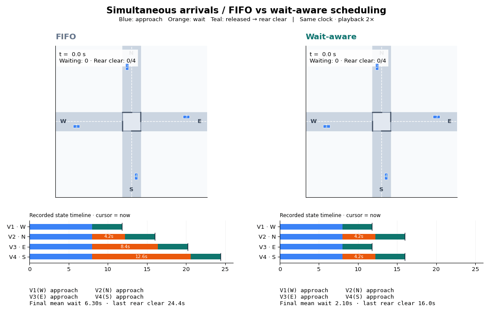
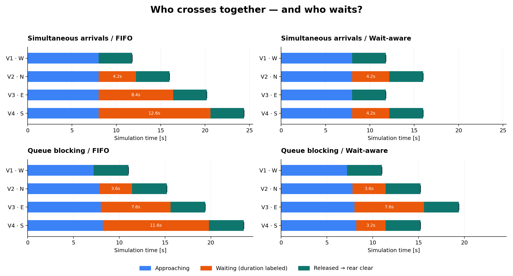
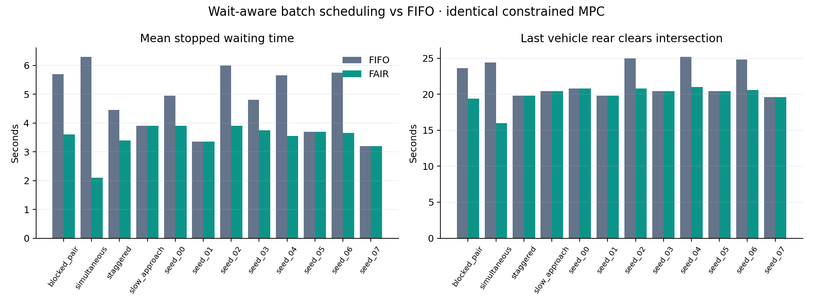
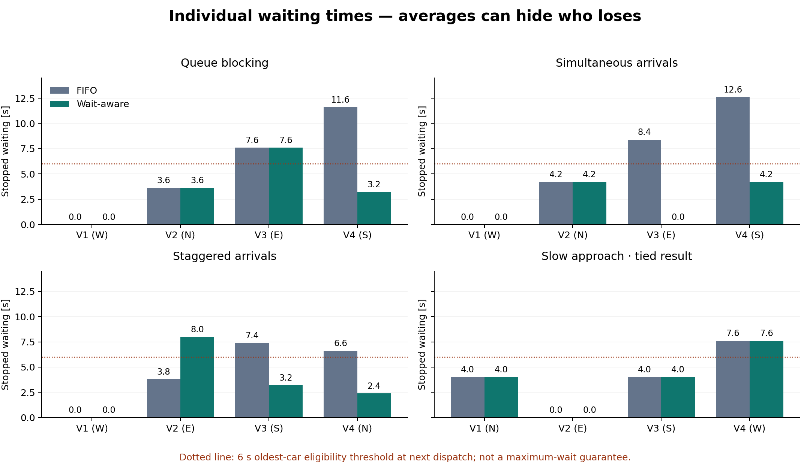
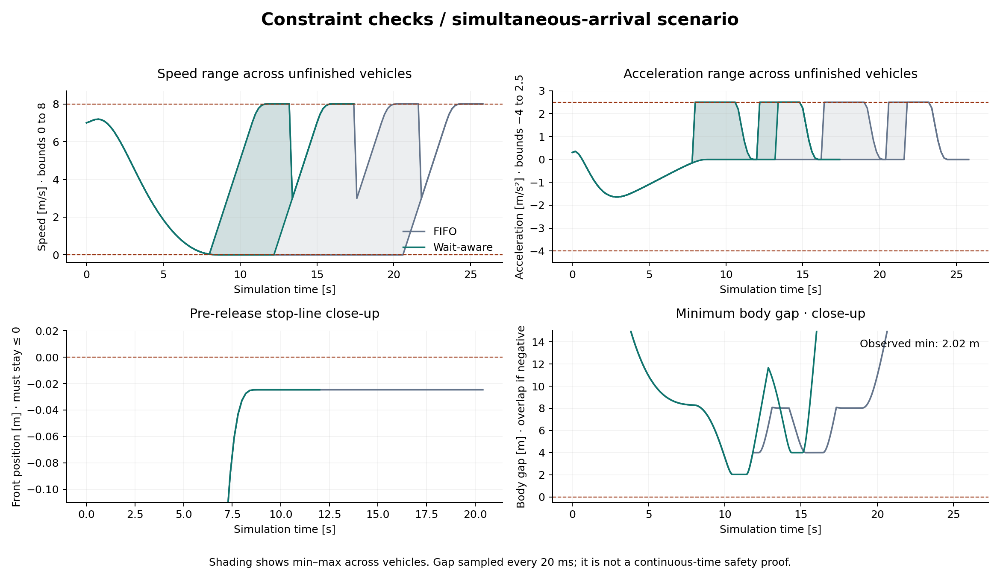
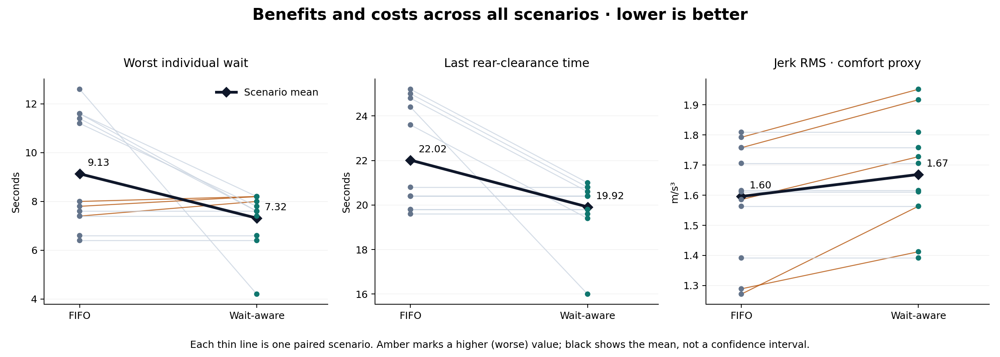
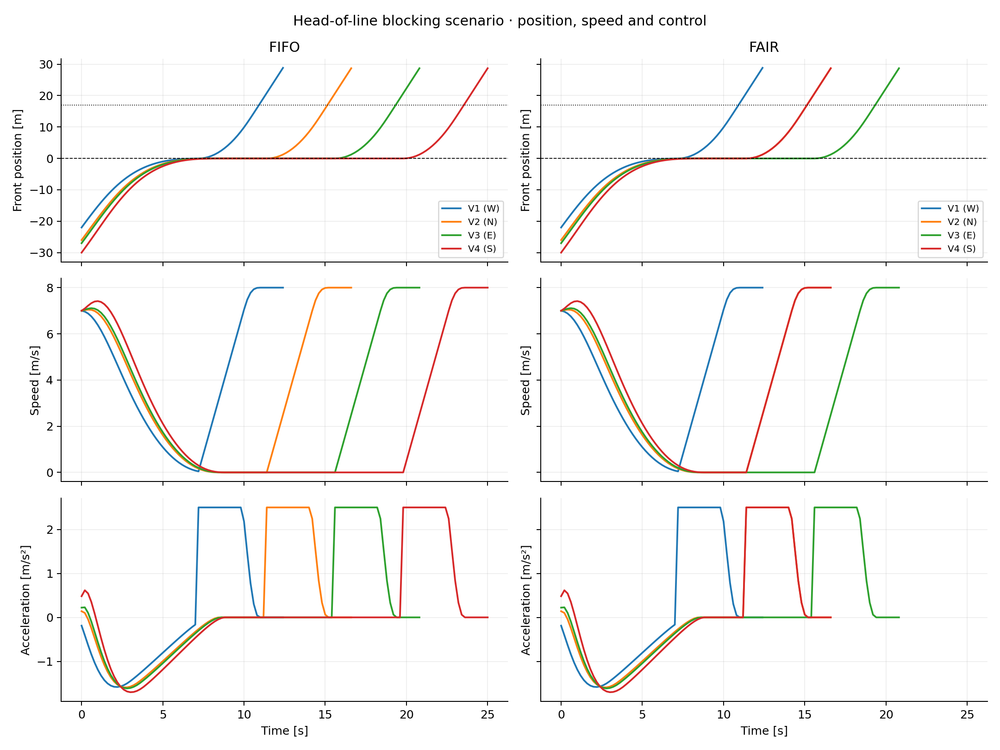
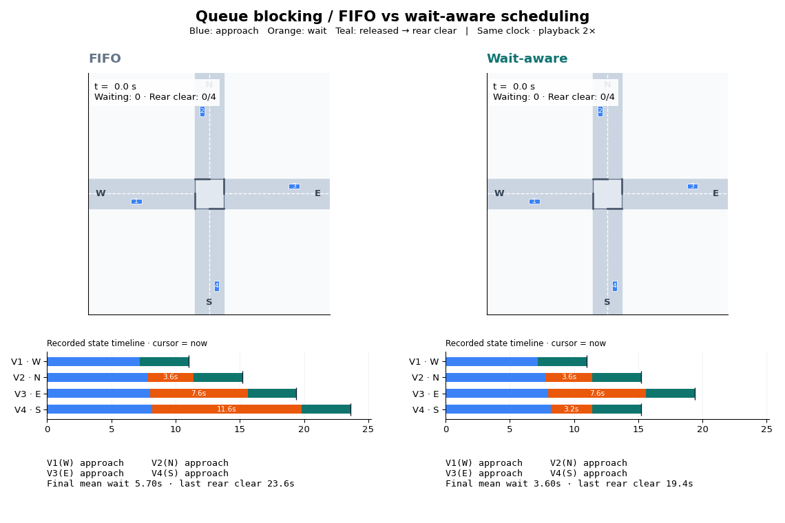
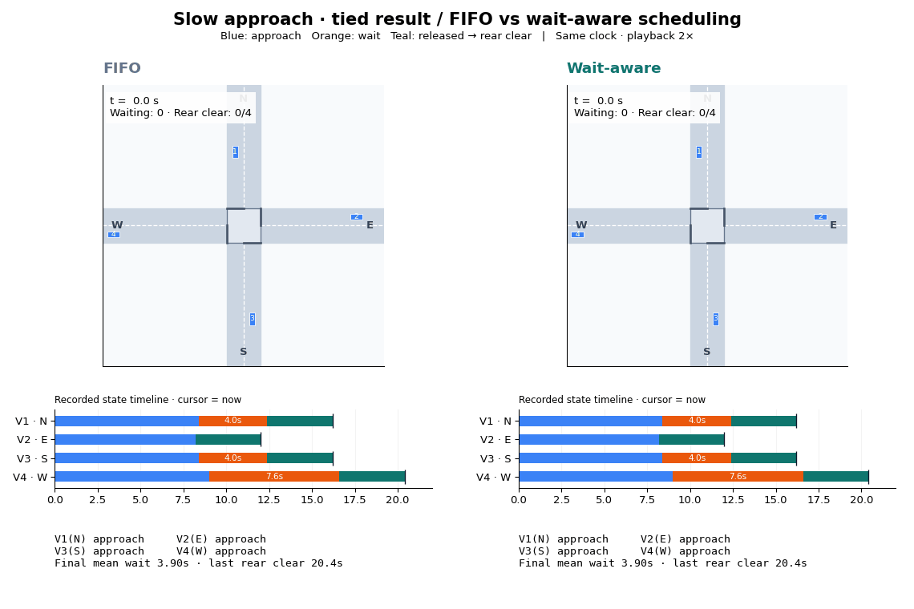

# Visual guide: wait-aware intersection MPC

All visuals come from the same recorded simulation runs used in
[metrics.csv](results/fair_mpc/metrics.csv). FIFO and wait-aware policies receive
identical starting conditions and use the same motion controller and clearance
rules. This is a four-vehicle, straight-through experiment with one car per
approach; it is not evidence for unrestricted traffic or real-world safety.

## 1. Watch the simultaneous-arrival comparison first



**Watch V1/W and V3/E.** The wait-aware scheduler releases this opposing pair
together. FIFO releases V1 alone because the next queued car, V2/N, conflicts.
The shared clock makes the difference visible: last rear clearance occurs at
16.0 s versus 24.4 s, with mean waiting 2.1 s versus 6.3 s.

Blue means approaching, orange means waiting, and teal means released. Vehicle
numbers remain fixed. The black cursor below each map marks the same simulation
time on a full recorded state timeline. Playback is 2× simulation speed; the
clock, wait ages and clearance counts display simulation time. Final metrics at
the bottom are labeled as final values, not running estimates.

[Open the GIF directly](results/fair_mpc/simultaneous.gif).

## 2. See exactly who crosses together



Overlapping teal intervals show concurrent releases. Orange widths show queue
waiting, with durations printed inside longer waits. The terminal tick marks
rear clearance, including the 0.5 m spatial margin. The blank interval before
the next batch includes the scheduler's 0.4 s guard time.

In simultaneous arrivals, wait-aware serves W/E together, then N/S together.
In queue blocking, the first W car still travels alone; the later N/S batch is
where the scheduler saves time. Do not describe that replay as W/E releasing
together at its first dispatch.

[SVG for presentation](results/fair_mpc/crossing_timeline.svg) ·
[Exact event times](results/fair_mpc/vehicle_events.csv) ·
[Released batches](results/fair_mpc/dispatch_batches.csv)

## 3. Check that the improvement is not just one example



The left panel compares mean queue waiting in every scenario. The right compares
the time until the last rear bumper clears. Waiting improves in eight of twelve
scenarios and ties in four. Mean waiting across scenarios drops 27.3%; average
last rear-clearance time drops 9.5%. These percentages use the aggregate values,
not an average of per-scenario percentage improvements.

The named scenarios are deliberate examples; seeds 0–7 add reproducible variation.
Twelve scenarios do not establish universal superiority.

## 4. Inspect the individual drivers



This chart prevents the average from hiding redistribution. In staggered arrivals,
V2/E waits **8.0 s rather than 3.8 s**, while V3/S and V4/N benefit. The six-second
line is the threshold that gives an oldest waiting vehicle priority at the next
dispatch. It is **not a hard six-second waiting limit**; an active batch cannot
be preempted.

[SVG for presentation](results/fair_mpc/vehicle_waits.svg)

## 5. Check the control and clearance traces



For simultaneous arrivals, the upper panels show speed and acceleration ranges
across unfinished vehicles. Shading is a min–max envelope, not a confidence band.
Dashed lines show the actual model constraints. Changes in which vehicles remain
unfinished can change an envelope abruptly; they are not individual vehicle jumps.

The lower-left panel zooms to the stop line and includes only pre-release samples.
Vehicles must stay at or below zero. The lower-right panel zooms the sampled
minimum body gap to 0–15 m; larger approach/departure gaps are outside the view.
Gap zero denotes touching and negative values denote rectangle overlap. Gap is
sampled every 20 ms and is not a continuous-time safety proof. This plotted
example has minimum body clearance about 2.02 m.

All 24 runs also undergo the simulation's bound/overlap checks. Plot event times
and reconstructed clearance are checked against their underlying traces and
summary metrics before export.

[SVG for presentation](results/fair_mpc/safety_controls.svg) ·
[Visual data checks](results/fair_mpc/visual_validation.csv)

## 6. Show the tradeoff, including the unfavorable result



Each thin line joins the two policy results for one scenario; amber indicates an
increase in a quantity where lower is better. Black diamonds show the mean
across scenarios. The left panel averages each scenario's worst individual wait;
it is not the single worst driver across the entire benchmark.

The right panel shows that average scenario jerk RMS increases about 4.6%.
The algorithm improves scheduling outcomes in this experiment, but does not
improve this ride-comfort proxy. Jerk RMS uses each policy's full simulation
duration, so this comparison includes differing observation lengths and zero
controls for vehicles already marked DONE; it does not isolate per-maneuver
passenger comfort.

[SVG for presentation](results/fair_mpc/tradeoffs.svg)

## 7. Inspect the underlying motion



Position, speed and acceleration for the queue-blocking episode use matching
axes between the two policies. The position references mark the stop line and
rear-clearance threshold. These curves end when each car is removed from the
demonstration, rather than extending its motion indefinitely.

## Two more replays



**Queue blocking:** watch the later N/S pair. Mean waiting decreases from
5.7 to 3.6 s; last rear clearance changes from 23.6 to 19.4 s.



**Slow approach:** both policies produce the same schedule and mean wait of
3.9 s. This replay shows a case where searching for a different batch provides
no benefit.

## Reproduce the gallery

```bash
python3 -m unittest -v
python3 fair_mpc.py --animate
```

The chart exporter is in [fair_visuals.py](fair_visuals.py). Without `--animate`,
the command produces all six charts and data checks but skips GIF rendering.
PNG files are convenient for viewing; SVG files for the four detailed charts
scale cleanly for slides. The three `_snapshot.png` files provide static frames
from the corresponding GIF renderer when animation is unavailable.
